# ShowyLauncher

Главный экран для телевизоров на Google TV, сделанный под одну задачу: быстро найти фильм или сериал и включить его.
Подборки, поиск, выбор озвучки и плеер собраны в одном месте, рекламы нет.

Я делал его для своих двух TCL G08 (Google TV 12 и 14), на них он и проверен. Должен работать на любом Google TV
или Android TV 9 и новее.

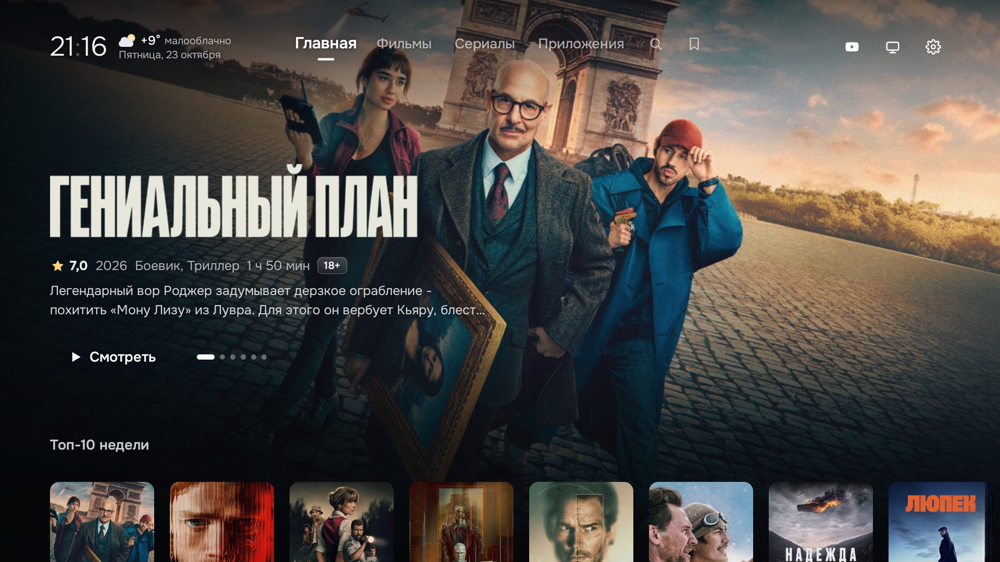

## Что умеет

На главном экране подборки: тренды недели, новинки в цифре, новые серии, сериалы Netflix, HBO и Apple TV+, жанры.
Фильмы ищутся с экранной клавиатуры или голосом, источники и озвучки берутся из Showy (нужен аккаунт, есть бесплатный).

Плеер встроенный. Он показывает 4K, HDR10 и Dolby Vision и передаёт звук Dolby Atmos на саундбар. Субтитры можно
вывести в две строки, например английские над русскими. Заставку можно пропустить кнопкой или автоматически, а
следующая серия включается сама после титров. Файл заранее скачивается на диск телевизора (до 8 ГБ вперёд, на паузе
тоже), поэтому тяжёлые фильмы реже останавливаются на подгрузку; сколько скачано и с какой скоростью, видно в панели.

«Продолжить просмотр» помнит, где вы остановились, и отмечает, когда вышла новая серия в вашей озвучке. Если дома
несколько телевизоров, их можно связать, и история станет общей.

## Установка

Есть два варианта.

**Как обычное приложение.** Ставится за пять минут прямо с телевизора через Downloader. Стандартный экран Google TV
остаётся, ShowyLauncher открывается из списка приложений.

**Как главный экран.** Нужен компьютер в той же сети. Скрипты отключают на телевизоре рекламу, слежку и
демо-режимы, затем ShowyLauncher заменяет экран Google TV и получает кнопки пульта: «Домой», микрофон, «Настройки» и
«Источник». Всё отключённое возвращается одной командой.

Подробно по шагам — в [docs/INSTALL.md](docs/INSTALL.md). Можно начать с приложения и позже сделать его главным
экраном, история при этом сохранится.

| | |
|---|---|
| 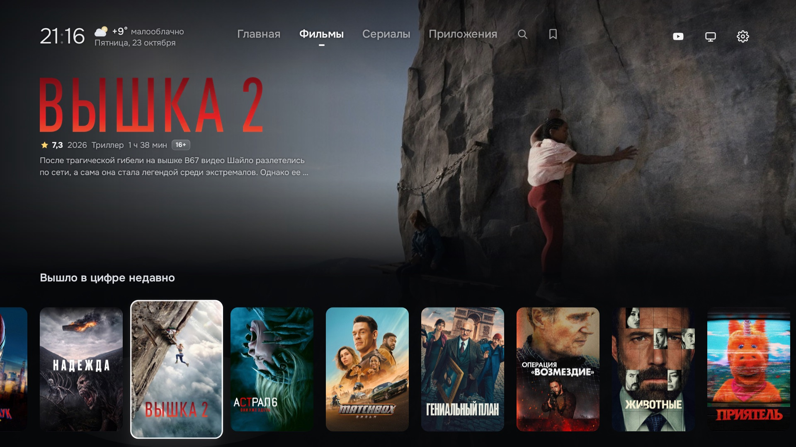 | 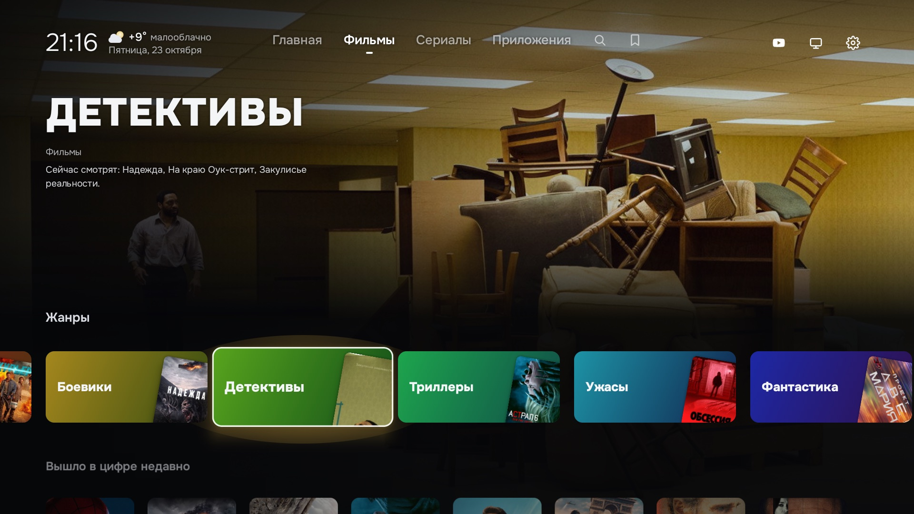 |
| 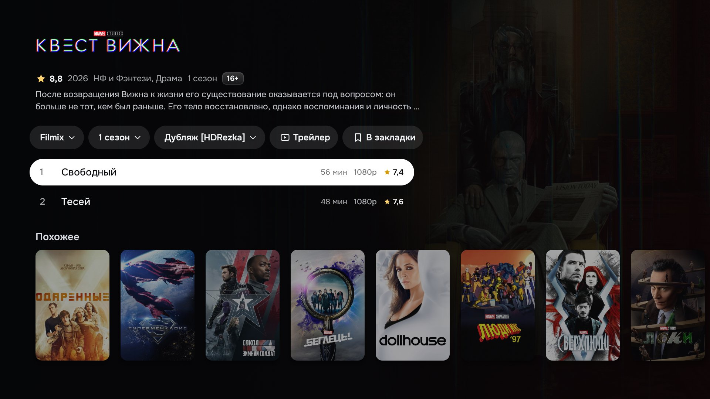 | 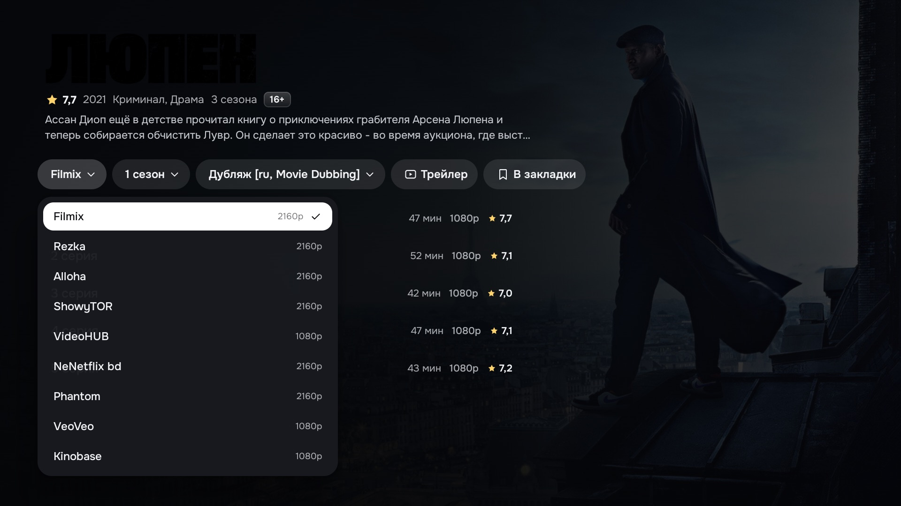 |
| 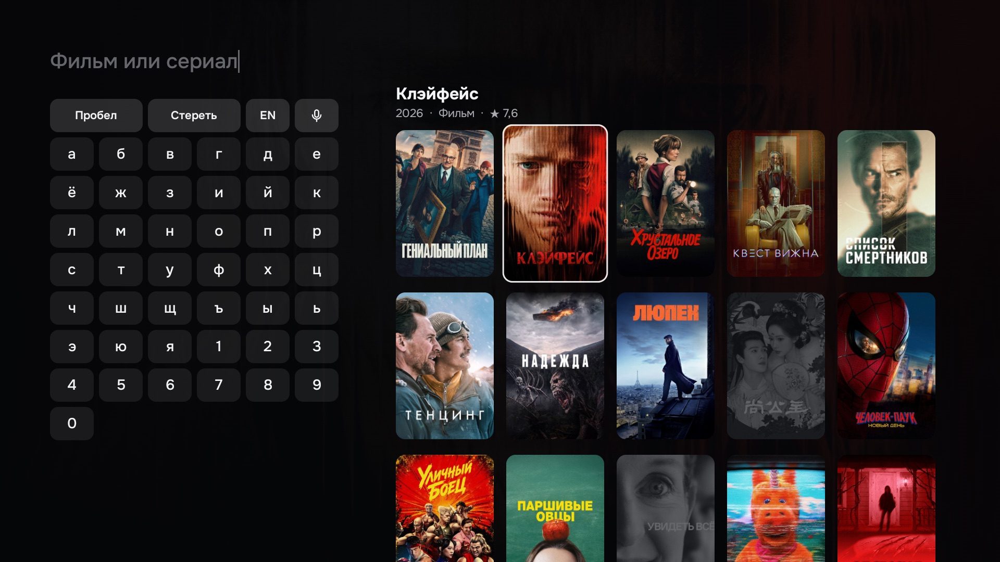 | 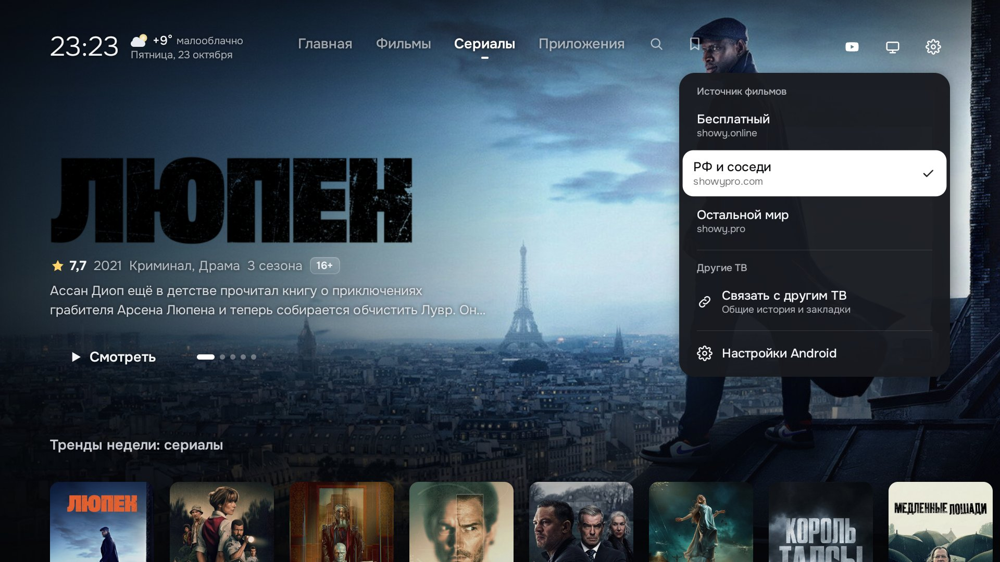 |
| 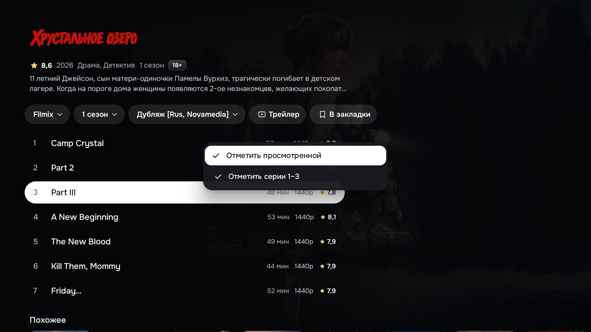 | 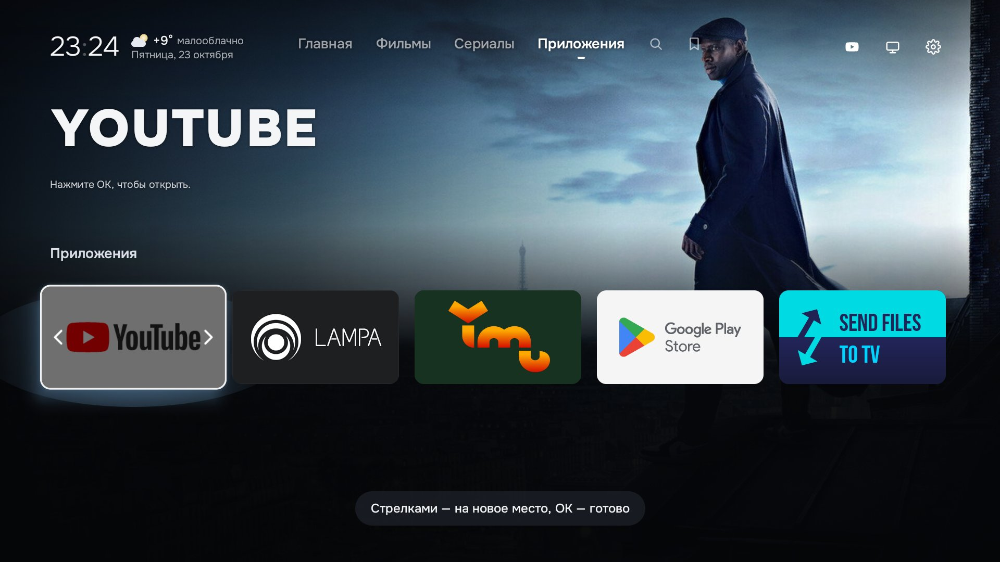 |
| 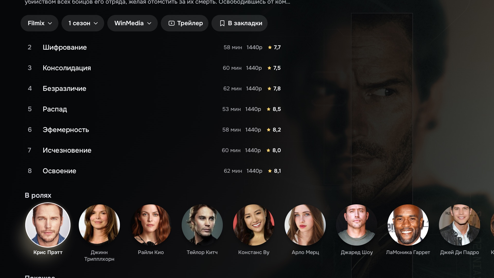 | 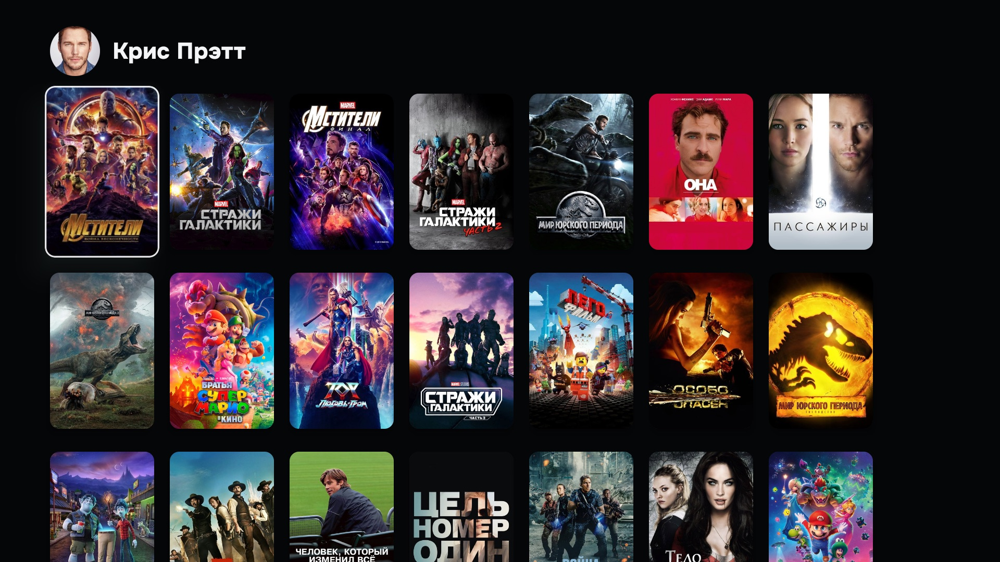 |

## Как пользоваться

Экран фильма открывается по OK на постере. Сверху выбираются источник, сезон и озвучка, ниже список серий, ещё ниже
актёры и похожие фильмы. Долгое нажатие OK открывает меню: на постере — закладки и «Продолжить», на серии —
отметка о просмотре, на приложении — переместить или скрыть.

В плеере OK ставит паузу и открывает панель со звуком, субтитрами и списком серий. Стрелки влево и вправо
перематывают на 30 секунд, вверх и вниз показывают панель без паузы, «Назад» закрывает меню, а затем плеер. Выбранные
субтитры и озвучка запоминаются для каждого сериала.

В шестерёнке: обновления, сервер Showy, автоматический пропуск заставок и связь с другими телевизорами.

Плеер ViMu ставить не обязательно. Если он есть, встроенный плеер отдаёт ему редкие файлы, которые не может открыть
сам, например образы Blu-ray.

## Лицензии

Данные о фильмах — TMDB. This product uses the TMDB API but is not endorsed or certified by TMDB. Источники — Showy,
отметки заставок — TheIntroDB, погода — MET Norway и Open-Meteo. Проект независимый и не связан с Showy, TMDB, Google
или TCL.

Шрифт Onest распространяется по SIL Open Font License (`FONT-LICENSE-OFL.txt`), значки PlayStation и Xbox — Simple
Icons (CC0). Идея очистки телевизора взята из CleanYourTV.

Код — [MIT](LICENSE).
